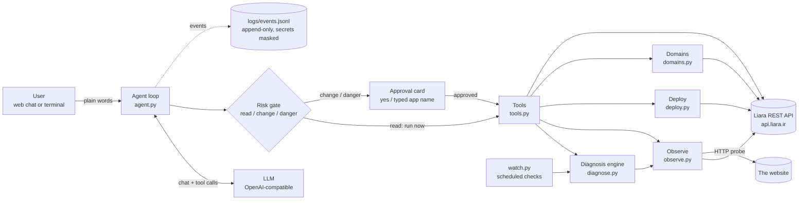

# StarCoach — a website assistant for Liara

StarCoach is an AI assistant for website owners on [Liara](https://liara.ir).
It helps with the whole cycle: choose a plan, deploy, watch, diagnose, fix, and check the fix.
You talk to it in plain Persian or English, in a web chat or a terminal.
It does read-only work by itself. It asks before anything risky.

This document is for reviewers. It covers the architecture, the Liara API connection, how users interact, the limits, and the results.

- How to run: [README](../README.md)
- Work log with proof for every change: [PROGRESS](PROGRESS.md)
- Decisions and measured facts: [DECISIONS](DECISIONS.md)
- Research with sources: [research/00-index.md](research/00-index.md)

---

## 1. What the MVP covers

| Part of the cycle | What StarCoach does | Command / tool |
|---|---|---|
| Choose a setup | Reads a project folder. Detects the platform (same order as the official CLI) and the port. Warns about known deploy failures. Picks the cheapest fitting plan from your account's real plan list. | `recommend`, tool `recommend_setup` |
| Create | Creates the app (after approval). | `create`, tool `create_app` |
| Deploy / publish a new version | Packs the folder (never `.env`), uploads it, creates a release, streams build logs, and reports the final state and the reason for a failure. No Liara CLI needed. | `deploy`, tool `deploy_app` |
| Service status | App state, instances, releases. | `apps`, `status`, tools `list_apps`, `app_status` |
| Monitoring | Logs, events (OOM, restarts), CPU/RAM against plan limits, our own HTTP probe (status codes, latency). | `logs`, `events`, `metrics`, `health` |
| Troubleshooting | Gathers evidence from 6 sources and ranks probable causes. Each cause has its evidence, a confidence, a fix, and an action when one is possible. | `diagnose`, tool `diagnose_app` |
| Fix | Set env var, restart, start/stop, change plan, redeploy. Always after approval. | `set-env`, `start`, `stop`, `resize`, tools |
| Check the fix | Waits for the app, probes it 5 times, and checks that the old error lines are gone. | `verify`, tool `verify_fix` |
| Automation | Scheduled checks. Alerts once per state change. The likely cause is attached. Optional auto-restart (max once per hour). | `watch` |
| Domains | Adds the domain, shows the DNS records, requests SSL, and gives step-by-step IRNIC / registrar instructions. | `domain`, tools `domain_guide`, `add_domain`, `enable_ssl` |
| Honesty about limits | A registry of what the Liara API cannot do. The assistant reads it before saying "impossible". | `limits`, tool `api_limits` |

**Demo scenario (end to end):**
"My shop site gives error 500" → the assistant reads logs, events, metrics and probes the site → top cause: `SHOP_DB_URL is not set` (evidence: the log line, `ECONNREFUSED 127.0.0.1:5432`, 5/5 probes return 500) → it offers `set_env SHOP_DB_URL` → the user approves on a card → Liara restarts the app → `verify_fix` waits, probes 5 times (all 200), and confirms the error line is gone → "fixed".
The demo app is in [`examples/demo-node`](../examples/demo-node). It is a real, dependency-free Node shop that fails exactly like a real app with a missing database setting.

---

## 2. Architecture

**Layers (each one is a CLI command, so it can be run and shown alone):**

1. `liara.py`: a small Liara REST client using only the Python standard library. It retries reads on 429/5xx and never retries changes. Liara errors become plain-language messages (balance, frozen app, plan limit, busy app, …).
2. `observe.py`, `deploy.py`, `domains.py`, `recommend.py`: the infrastructure capabilities.
3. `diagnose.py`: a **deterministic** rule engine. The LLM never invents causes; it explains the engine's ranked output in the user's language.
4. `tools.py`: one registry. Every tool has a JSON schema, a **risk tier** (`read`, `change`, `danger`), and a list of secret arguments that are masked.
5. `agent.py`: the tool-calling loop (max 8 rounds) with the risk gate **in code**, not in the prompt.
6. `web.py` + `static/index.html`: the local web chat (stdlib server, server-sent events). `cli.py`: every capability as a command.
7. `watch.py`: unattended monitoring.

**Why these choices**

| Choice | Why |
|---|---|
| No Liara CLI; direct REST | The CLI is Node-based and interactive. The API gives us progress events and structured errors (research 02). |
| Deterministic diagnosis + LLM explanation | Causes are repeatable, testable and measurable against a baseline (section 6). The LLM adds plain-language explanation and conversation. |
| Approval enforced in code | A prompt can be ignored or injected (for example by text in app logs). The gate in `agent.py` cannot. |
| OpenAI-compatible LLM API | Works with the user's provider, Liara's AI gateway, or any other compatible one (D3). |
| Standard library only at runtime | Fewer dependencies, easy install, nothing to break. `pytest` is the only dev dependency. |
| Persian-first UI, bilingual messages | The users are Iranian website owners (D4). Diagnosis titles and fixes exist in both languages. |

---

## 3. How we connect to the Liara API

- **Base URL:** `https://api.liara.ir` (the official CLI default; F4). Change it with `LIARA_API_URL`.
- **Auth:** `Authorization: Bearer <token>`. Create the token in the Liara console → API, and put it in `.env` as `LIARA_API_TOKEN`. `.env` is git-ignored.
- **Connection test:** `uv run starcoach check` calls `GET /v1/me`, `GET /v1/projects` and `GET /v1/billing`, then prints your name, app count and balance. Only the name is shown, because `/v1/me` also holds personal data and storage keys.
- **Teams:** if your apps and wallet are in a Liara team, set `LIARA_TEAM_ID` (from `uv run starcoach teams`, which calls `GET /v2/teams`). Every request then carries `?teamID=`, like the official CLI, and the team's wallet pays (F15).

**Endpoints used**

| Purpose | Endpoint |
|---|---|
| Account, plans, balance, teams | `GET /v1/me` (only `plans` and the name are kept), `GET /v1/billing`, `GET /v2/teams` |
| Apps | `GET /v1/projects`, `GET /v1/projects/{app}`, `POST /v1/projects`, `GET /v1/networks` |
| Instances, releases | `GET /v1/projects/{app}/applets`, `GET /v1/projects/{app}/releases`, `GET /v1/releases/{id}` |
| Deploy | `POST /v2/projects/{app}/sources` (multipart tar.gz), `POST /v2/projects/{app}/releases`, `GET /v2/releases/{id}/build-logs` |
| Logs, events | `GET /v2/projects/{app}/logs`, `GET /v1/projects/{app}/events` |
| Metrics | `GET /v1/projects/{app}/metrics/cpu`, `/metrics/memory` |
| Lifecycle | `POST /v1/projects/{app}/actions/restart`, `/actions/scale`, `POST /v1/projects/{app}/resize` |
| Env vars | `POST /v1/projects/update-envs` (full replace → we merge first) |
| Domains | `GET/POST /v1/domains`, `GET /v1/domains/{id}/check`, `POST /v1/domains/provision-ssl-certs` |

Every endpoint is cited to the official OpenAPI spec or CLI source in [research](research/00-index.md).

**Security of sensitive data**

- Secrets live only in `.env`. They are masked in every log line (`config.mask`), and never sent to the LLM.
- Env var **values** never reach the LLM. Only names do. A value the user approves is shown as `***` in status lines and logs.
- `.env` files in a project are never uploaded on deploy, even where the official CLI would upload them.
- `set_env` refuses to run when the app has encrypted env vars. The full-replace API could overwrite them with masked values.
- The web server binds to `127.0.0.1` only.
- App log text is marked to the LLM as data, never instructions (prompt-injection defence). Risky actions still need the user's click.

---

## 4. How the user interacts

**Web chat** (`uv run starcoach web` → http://127.0.0.1:8790), the main interface:

- Type a request in Persian or English, or press a quick-start button ("my site has errors", "my site is slow", "publish my project", …).
- A **live timeline** shows each step: "reading logs…", "✅ done", deploy build lines.
- **Approval cards** appear for risky steps. Each card says in plain Persian what will happen and its impact (downtime, cost), with the exact arguments.
  - `change` actions (restart, set env, deploy, create): click **Approve** or **Reject**.
  - `danger` actions (stop app, change plan): you must also **type the app name**.
  - An approval is single-use and tied to the exact action shown. No answer within 10 minutes counts as reject.
- Answers explain causes in order, with evidence, confidence and the fix. After a fix, the assistant reports the check result with numbers.
- A reload rebuilds the conversation. A lost connection does not lose events.

**Terminal:** `uv run starcoach chat` does the same in a terminal. `yes` / `بله` approves. Danger actions need the app name typed. Every capability is also a direct command (`diagnose`, `deploy`, `watch`, …). See the README.

**Risk tiers**

| Tier | Runs | Examples |
|---|---|---|
| read | at once, automatically | list apps, status, logs, events, metrics, probe, diagnose, verify, domain guide |
| change | after "Approve" | create, deploy, restart, set env, start, add domain, SSL |
| danger | after "Approve" + typing the app name | stop app, change plan |

---

## 5. Limitations

**Liara API limits** (also returned by `starcoach limits` and the `api_limits` tool, in Persian and English):

- No API for request counts, 5xx rate or latency. We probe the site ourselves.
- No restart counter. Crashes are inferred from events and logs.
- The live health-check result is not exposed.
- No documented rollback endpoint. To roll back we redeploy an older version.
- Console notifications have no API or webhook. `watch` polls instead.
- Registrar changes (IRNIC nameservers) are done by the user in the registrar panel. We give exact steps.
- Metric units are not documented. We measured them: CPU in cores, memory in bytes, a point every 30 s (F21).
- The logs API returns at most 100 lines per call (F19). Events come as container lifecycle records (create, start, kill, die), not as documented (F20).
- Payments (topping up the balance) cannot be made through the API.

**Our own limits:**

- Diagnosis rules cover common Node, Python/Django/Flask, PHP/Laravel and platform failures (24 log signatures plus metric, probe and state rules). An unknown error is reported as "server error, cause not identified" with the log lines, not guessed.
- Rule weights are design choices from research 06. They are tuned on 34 written incidents, not yet on many real ones.
- Ignore files: `!negation` patterns and nested ignore files are not supported by our packer.
- One user, local only. No accounts, no multi-tenant server.
- A custom domain was not added live: we own no test domain. The domain list endpoint was read for real.

---

## 6. Results

**Diagnosis quality** (`uv run starcoach eval` → [`results/diagnosis-eval.json`](../results/diagnosis-eval.json)):
34 labelled incidents in 3 sets, compared with a naive baseline ("take the first error line and match it").

| Set | Cases | First run of engine (top-1) | Baseline (top-1) | After fixes (top-1) |
|---|---|---|---|---|
| dev | 8 | 100% | 25% | 100% |
| holdout-1 | 14 | 92.9% | 57.1% | 100% |
| holdout-2 (fresh) | 12 | **66.7% (lost to baseline)** | 75% | 100% |

We report the first runs honestly (F6, F7). The holdout-2 loss showed two real design flaws. A confidence cut-off hid moderate causes, and one loopback signature was missing. Both were fixed. All three sets have now been used for tuning, so the honest test is the real incident below.

**Tests:** 82 offline tests (`uv run pytest -q`, no network). They cover the API client, teams, the deploy flow, log and event parsing (real response shapes), diagnosis, verification with restart blips, approvals over HTTP, watch dedupe, and secret masking.

### Real runs on Liara (2026-10-23, team «لیارا», demo app `starcoach-shop`)

| Step | Command | Real result |
|---|---|---|
| Connect | `starcoach check` | connected; team balance 1,998,014 Toman (F15) |
| Choose a plan | `starcoach recommend examples/demo-node` | node, port 3000; `small-g2` + `basic` ≈ 749,998 Toman/month, cheapest of 42 real plans (F11) |
| Create | `starcoach create shop …` | `starcoach-shop` created on network `starcoach` |
| Deploy | `starcoach deploy examples/demo-node --app starcoach-shop` | PENDING → BUILDING → DEPLOYING → READY in **23 s**, no Liara CLI (F22) |
| See the failure | `starcoach health starcoach-shop` | 5/5 × **500**, p50 134 ms |
| Diagnose | `starcoach diagnose starcoach-shop` | 1. missing env var `SHOP_DB_URL` (**86%**), which explains 2. DB connection refused (54%) |
| Fix + verify (agent) | web chat → approve card → `set_env` → `verify_fix` | 5/5 × **200**, old errors gone |
| Full live eval | `uv run python evals/live_scenario.py starcoach-shop --yes` | all 5 checks pass, 99.5 s from the user's first message to verified fix → [`results/live-scenario.json`](../results/live-scenario.json) |
| Monitor | `starcoach watch starcoach-shop --once`, `metrics`, `logs`, `events` | alert `unknown → up`; RAM 29 MB of 512, CPU 0.02 of 0.5 cores |

**Real LLM behaviour** (`evals/llm_scenario.py`, 5 runs): 5/5 passed after one prompt fix. Before the fix, 1 of 2 runs asked "do you approve?" in text on top of the approval card (F9).

**What the real system taught us** (each one fixed, with a test):
- The first real incident ranked the symptom above the root cause (top-1 miss). Repeated identical log lines measured traffic, not likelihood. Fixed with distinct-line counting and a causal-chain rule (F17).
- Logs come in pages of 100. We were reading the oldest page (F19).
- Events have an undocumented shape. A planned restart (kill → die) must not count as a crash (F20).
- After an env change the old container keeps logging errors until the new one starts, and Liara may restart the new container once more. Verification now reads only logs written after recovery, spreads its probes over 40 s, and reports blips honestly (F18, F23).
- Only log lines from the current release count in a diagnosis, so a fixed app is not reported as broken.
- The machine's VPN proxy could not reach `*.liara.run`, so the probe connects directly, like a visitor (F16, D8).
- The agent under-quoted the cost (plan without bundle). `recommend` now gives totals (F13).
- The apps and wallet were in a team, so team support was added (F15, D9).
